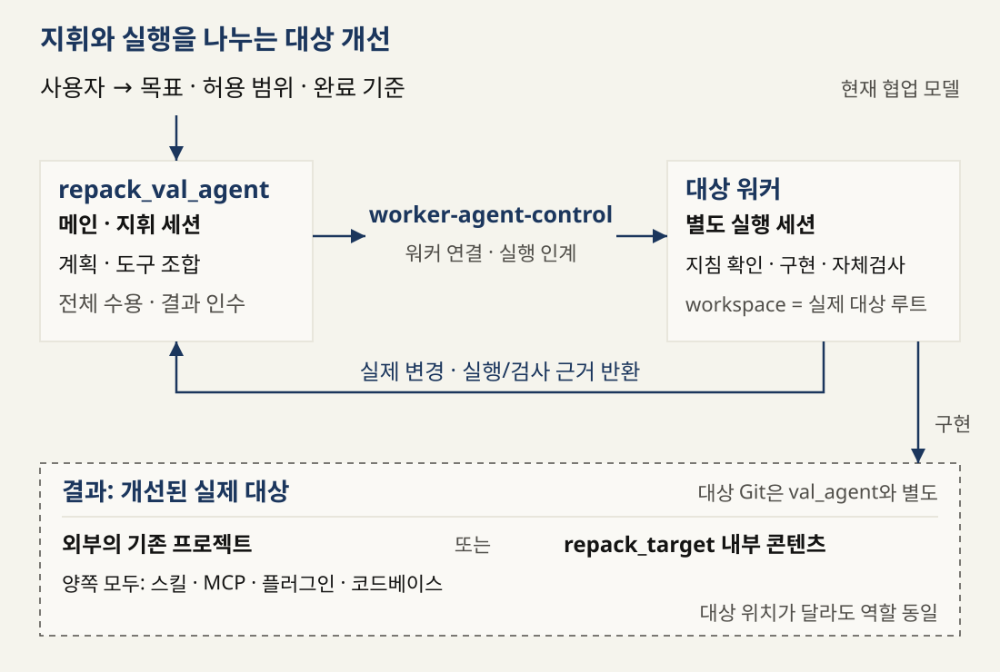
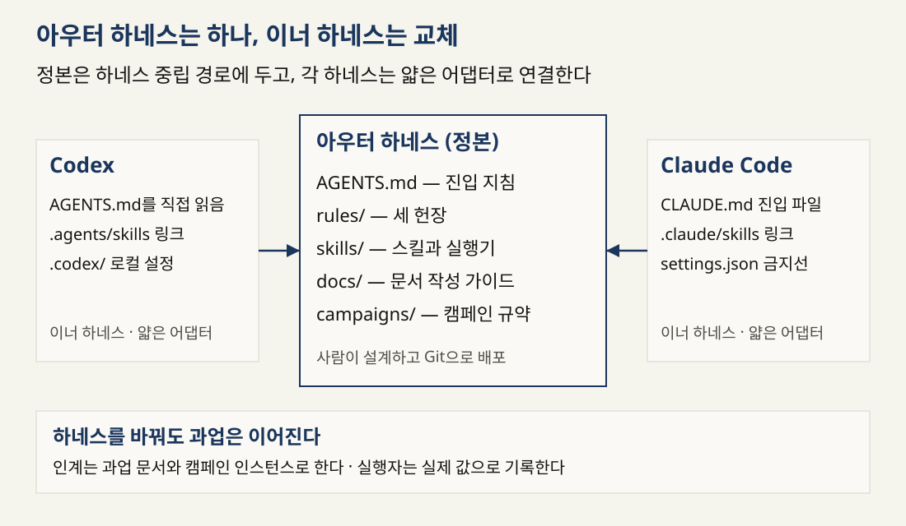
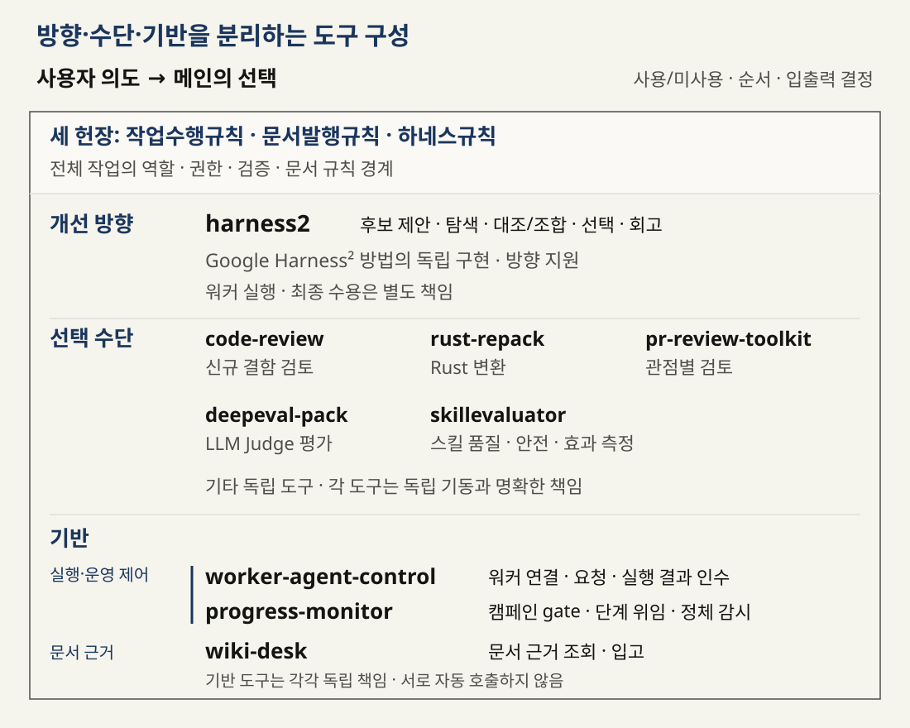
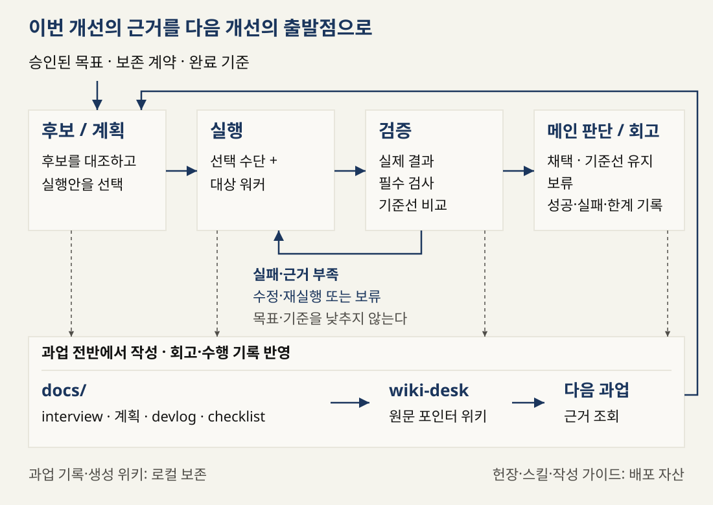
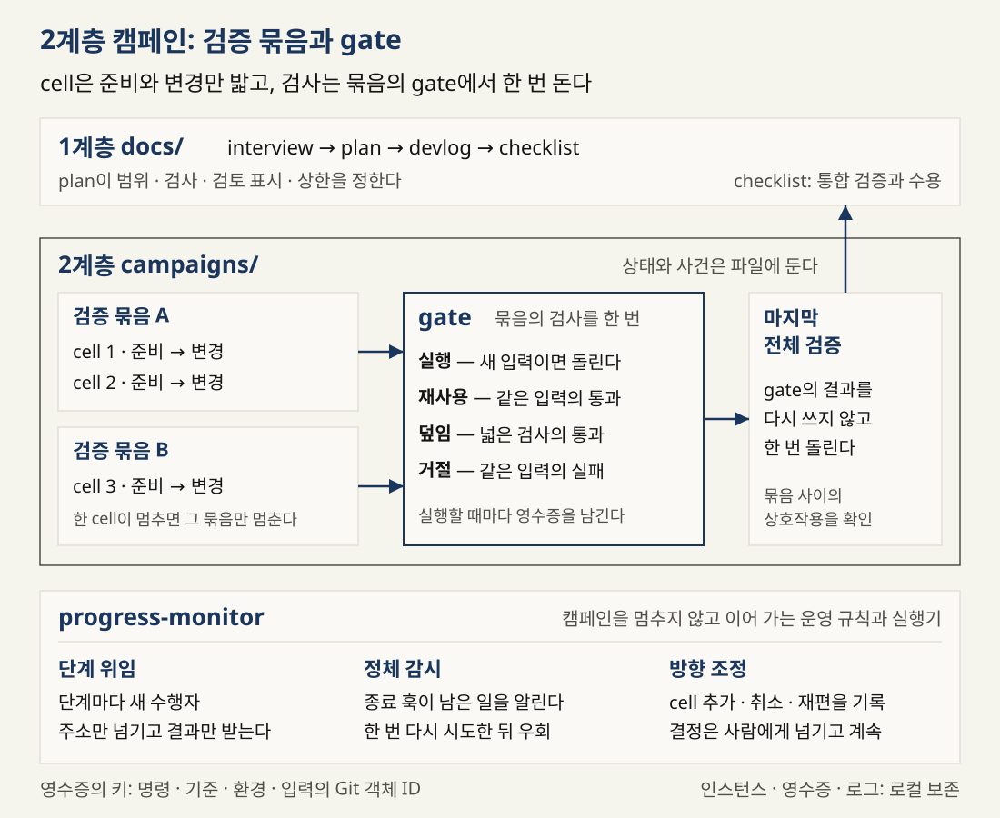

# repack_val_agent

> **독립된 에이전트와 도구를 연결해 대상을 개선하고, 그 근거를 다음 개선으로 이어 갑니다.**

repack_val_agent는 코드베이스·스킬·MCP·플러그인 등의 **개선을 지휘하는 오케스트레이터 작업 공간**입니다. 사용자가 목표와 완료 기준을 정하면, 메인 에이전트가 대상 워커와 도구의 역할을 나누고 실제 변경과 검사 근거를 확인합니다. 개선된 결과물과 함께 다음 과업에서 다시 꺼내 쓸 수 있는 의도·결정·실패·검증 기록을 남깁니다.

## 지휘와 실행을 나누는 개선 협업

대표 협업 모델은 **오케스트레이터와 분리된 대상 워커**입니다. 메인은 사용자와 목표·권한·완료 기준을 정리하고, 워커는 대상 프로젝트의 지침과 허용 범위 안에서 구현과 자체검사를 수행합니다. 메인은 반환된 파일과 실행 근거를 확인해 다음 작업과 최종 수용 여부를 판단합니다.



여기서 분리하는 것은 **에이전트의 실행 맥락과 책임**입니다. 같은 CLI를 쓰는 별도 세션끼리도 이 협업 구조를 구성할 수 있습니다. 구체적인 역할 배치·위임·독립 검증 조건은 [작업수행규칙](rules/workflow.md)과 각 과업의 계획에 둡니다.

워커 연결의 기반은 [worker-agent-control](skills/worker-agent-control/SKILL.md)입니다. 이 스킬은 [hermes-subagent-control-plane](https://github.com/tbvjvsladla/hermes-subagent-control-plane)을 바탕으로 Claude Code와 Codex 워커를 호출합니다. 워커별 작업 경로·실행 CLI·진입 지침을 구분하고, 연결 확인과 본작업 결과를 따로 검증합니다. 계보와 적용 차이는 [적용 기록](skills/worker-agent-control/references/adaptation.md)에 있습니다.

### 어떤 이너 하네스로도 같은 규칙

이 저장소가 배포하는 것은 사람이 설계한 **아우터 하네스**(헌장·스킬·과업 문서 체계)입니다. Codex, Claude Code, Antigravity CLI(`agy`)는 이 저장소를 오케스트레이터 작업 공간으로 열 수 있는 **이너 하네스**입니다. 정본은 `rules/`, `skills/`, `AGENTS.md`에 둡니다. Codex와 Antigravity CLI는 `AGENTS.md`와 `.agents/skills/` 심볼릭 링크를 공유하고, Claude Code는 `CLAUDE.md`로 `AGENTS.md`를 불러오며 `.claude/skills/` 심볼릭 링크를 읽습니다. 하네스를 전환할 때는 과업 문서로 진행 상태를 넘기고 실제 실행자를 기록합니다. [하네스규칙](rules/harness.md) · [Antigravity 검색 경로](https://antigravity.google/docs/customization-discovery/)



### 개선 대상은 두 곳에 둘 수 있습니다

| 위치 | 작업 방식 | 결과와 Git 경계 |
|---|---|---|
| **외부의 기존 프로젝트** | 원래 작업 공간에 둔 채 워커를 실제 대상 루트에 연결합니다. | 대상의 소스·개선 결과·Git 이력은 해당 프로젝트에서 관리합니다. |
| **`repack_target/` 내부 콘텐츠** | 스킬·MCP·플러그인·코드베이스 등을 준비하고 선택한 콘텐츠 루트에 워커를 연결합니다. | 실제 콘텐츠와 결과는 로컬에 보존하고, val_agent에서는 폴더 지침만 배포합니다. |

어느 쪽에 두든 최종 산출물은 **개선된 대상 자체**입니다. 대상의 위치가 지휘와 실행의 책임을 바꾸지는 않습니다. 대상 소스와 결과물은 val_agent의 Git 배포에 넣지 않으며, 대상 자체의 커밋·배포는 해당 과업의 범위로 정합니다. 실제 대상 루트·허용 수정 범위·검증 방법은 과업 계획에 명시합니다.

## 개선 방향·수단·기반을 분리합니다

개선 목표는 과업마다 다릅니다. 어떤 과업에는 Rust 변환이, 다른 과업에는 결함 검토나 LLM 답변 평가가 필요합니다. repack_val_agent는 **개선 방향을 다루는 도구**, **선택 가능한 수단 도구**, **작업을 받치는 기반 도구**를 구분해 조합합니다.

기반 도구는 과업이 바뀌어도 그대로 유지합니다. **실행·운영 제어** 계열인 `worker-agent-control`과 `progress-monitor`, **문서 근거**를 맡는 `wiki-desk`가 여기에 속합니다. `worker-agent-control`이 워커 한 번의 위임·실행·결과 인수를 다룬다면, `progress-monitor`는 그 위임이 여러 항목과 단계로 길게 이어질 때 검증 묶음의 gate·단계 위임·정체 감시로 흐름을 제어합니다([아래](#오래-걸리는-개선은-캠페인으로-나눠-이어-갑니다)). 수단 도구는 과업 성격에 맞춰 골라 쓰거나 교체·추가하며, 도구 사이의 구체적인 연결은 메인 오케스트레이터가 맡습니다.



| 구분 | 도구 | 책임 |
|---|---|---|
| **개선 방향** | [harness2](skills/harness2/SKILL.md) | 무엇을 바꿔 볼지 제안하고, 후보의 탐색·대조·조합·선택·회고를 근거와 연결합니다. |
| **선택 가능한 수단** | `code-review` · `rust-repack` · `pr-review-toolkit` · `anti-code-slop` · `deepeval-pack` · `skillevaluator` 등 | 이번 개선에 필요한 변환·검토·평가를 각자의 책임 범위에서 수행합니다. |
| **기반: 실행·운영 제어** | [worker-agent-control](skills/worker-agent-control/SKILL.md) | 대상 워커를 연결하고, 요청·실행·결과 인수를 다룹니다. |
| **기반: 실행·운영 제어** | [progress-monitor](skills/progress-monitor/SKILL.md) | 오래 걸리는 과업에서 검증 묶음의 gate와 영수증, 단계 위임, 정체 감시, 방향 조정을 다룹니다. |
| **기반: 문서 근거** | [wiki-desk](skills/wiki-desk/SKILL.md) | 프로젝트 문서의 원문 근거를 찾고, 새 기록을 포인터 위키에 입고합니다. |

### 수단 도구는 독립적으로 기동하고, 과업에서 조합합니다

수단 도구를 조합하는 원칙은 **어댑터 패턴**입니다. 각 도구는 입력·수행 범위·산출물·실행 근거를 스스로 정의하며 독립적으로 동작합니다. 사용자는 필요한 도구의 사용 여부와 연계 방식을 정하고, 메인은 이를 과업 계획의 역할·입출력·순서로 구체화합니다.

| 수단 도구 | 선택할 때 | 반환하는 책임 범위 |
|---|---|---|
| [code-review](skills/code-review/SKILL.md) | PR이나 로컬 변경의 신규 결함을 찾을 때 | 근거를 재검증해 엄선한 결함·규칙 위반 |
| [rust-repack](skills/rust-repack/SKILL.md) | 다른 언어의 로직 또는 기존 Rust를 개선할 때 | 외부 동작을 보존하는 Rust 변환·리팩토링과 자체검사 |
| [pr-review-toolkit](skills/pr-review-toolkit/SKILL.md) | 테스트·주석·오류 처리·타입·품질 등 여러 관점을 검토할 때 | 선택한 관점의 검토 결과 |
| [anti-code-slop](skills/anti-code-slop/SKILL.md) | AI가 남긴 억제 주석·주석 처리 코드·예외 삼킴·변명 주석 등을 감사하거나, 허용 경로와 수정 유형을 정해 고칠 때 | 스크립트가 판정한 `COMPLETE`/`INCOMPLETE`, 수정 내역·정당한 보존·제안·강제되지 않은 제약 |
| [deepeval-pack](skills/deepeval-pack/SKILL.md) | 답변·검색 문맥·기대 답변을 평가할 때 | 설정한 Judge·메트릭에 따른 케이스별 점수·이유·오류 |
| [skillevaluator](skills/skillevaluator/SKILL.md) | 스킬의 형식·안전·품질을 점검하거나, 스킬 유무에 따른 에이전트 결과를 비교할 때 | 단계(Tier)별 점수·판정·발견 사항과 실행하지 않은 범위 |

### 선택 수단은 꺼진 채 배포하고, 필요할 때만 켭니다

선택 가능한 수단 여섯 개는 **모두 꺼진 상태로 배포**합니다. 꺼진 스킬은 하네스가 발견하지 못하므로 세션의 스킬 목록과 맥락에 올라오지 않습니다.

**등록 방식.** 스킬의 정본은 `skills/<name>/`에 있습니다. Codex와 Antigravity CLI는 `.agents/skills/<name>`, Claude Code는 `.claude/skills/<name>`의 상대 심볼릭 링크로 스킬을 찾습니다. 기반 도구와 `harness2`의 링크는 Git이 추적합니다. 반면 선택 수단의 링크는 Git 추적에서 제외되며, 활성화 설정(knob)에 따라 생성되거나 제거됩니다.

| 파일 | 추적 | 내용 |
|---|---|---|
| `skill-activation.yaml` | 추적·배포 | 공유 기본값으로, 여섯 스킬 모두 `off`입니다. 여기에 등재된 스킬이 곧 선택 수단이며, 켤 때 필요한 MCP 등록과 준비 단계(`mcp`, `setup`)도 함께 적습니다. |
| `skill-activation.local.yaml` | Git 제외 | 이 작업 공간의 로컬 값입니다. 사람과 캠페인이 수정하며, 공유 기본값보다 우선합니다. |

knob의 값이 정본이며, [scripts/skill_activation.py](scripts/skill_activation.py)가 이 값에 맞춰 링크를 결정론적으로 동기화합니다. 스크립트는 공유 knob에 등재된 스킬의 링크만 만들거나 지우며, 같은 자리에 심볼릭 링크가 아닌 파일이 있으면 건드리지 않고 실패합니다.

```bash
python3 scripts/skill_activation.py status          # 스킬별 병합 값·링크 상태·MCP 등록
python3 scripts/skill_activation.py sync --apply    # 링크를 knob에 맞춤 (--apply 없으면 계획만)
python3 scripts/skill_activation.py check           # knob·링크 불일치, 꺼진 스킬의 MCP 잔여, 열린 캠페인 기록 검사
```

**사람이 직접 켜고 끄기.** `enable`과 `disable`은 로컬 knob을 갱신한 뒤 `sync`를 실행합니다. `--apply`를 생략하면 실제 변경 없이 적용 계획만 보여 줍니다.

```bash
python3 scripts/skill_activation.py enable deepeval-pack --apply
python3 scripts/skill_activation.py disable deepeval-pack --apply
```

- `skill-activation.local.yaml`에 `<name>: on|off`를 직접 적은 뒤 `sync --apply`를 실행해도 결과는 같습니다.
- 의존성 설치와 MCP 등록은 사용자가 직접 진행합니다.
  - `enable`은 준비 단계와 하네스별 MCP 등록 방법을 출력합니다. Antigravity CLI는 출력된 `agy.config.mcpServers` 항목을 로컬 `.agents/mcp_config.json`에 병합하면 됩니다.
  - `disable`은 남아 있는 MCP 등록을 지우는 방법을 출력합니다. 검사 대상 설정에 꺼진 스킬의 MCP 등록이 남아 있으면 `check`가 실패합니다.
- 바뀐 활성 상태는 하네스의 **새 세션**부터 반영됩니다. 하네스가 세션을 시작할 때 스킬을 발견하기 때문입니다.

**캠페인이 관리하는 방식.** 캠페인([campaigns/](campaigns/README.md))을 열고 닫을 때는 [progress-monitor](skills/progress-monitor/SKILL.md)의 실행기 `pm.py`가 활성화 스크립트를 호출합니다. `progress-monitor`는 특정 스킬의 이름을 코드에 고정하지 않고, 후보를 늘 공유 knob에서 읽습니다.

1. **열 때 묻기(HITL):** `pm.py open`을 `--skills` 없이 실행하면 공유 knob의 후보를 보여 주고, `skill-selection` 유형의 사람 확인 요청을 남긴 채 0이 아닌 종료 코드로 멈춥니다.
2. **고른 것만 켜기:** 사용자가 선택하면 `pm.py open --skills rust-repack,code-review`처럼 다시 엽니다. 아무것도 켜지 않으려면 `--skills none`을 지정합니다.
   - 고른 스킬 가운데 꺼져 있던 것만 켜고, 그 목록을 `campaigns/<id>/activation.json`의 `enabled`에 기록합니다.
   - 이미 켜져 있던 스킬은 `pre_existing`에 기록합니다.
   - 링크 동기화에 실패하면 knob과 링크를 열기 전 상태로 되돌리고 캠페인을 열지 않습니다.
3. **한 번에 하나:** 이미 열린 다른 캠페인이 있으면 새 캠페인을 열지 않습니다.
4. **닫을 때 끄기:** `pm.py close`는 그 캠페인이 켰고 지금도 켜져 있는 스킬만 끈 뒤 `campaigns/ACTIVE`를 지웁니다.
   - 열기 전부터 켜져 있던 스킬과 수행 중에 사람이 직접 끈 스킬은 그대로 둡니다.
   - 마지막 전체 검증이 통과하지 않았다면 `--reason <사유>`를 함께 넘겨야 닫힙니다.
5. **수동으로 정리한 경우:** `ACTIVE`를 직접 지웠다면 `python3 scripts/skill_activation.py campaign-close <id>`로 해당 캠페인이 켠 스킬을 꺼야 합니다. 그러지 않으면 기록이 열린 채 남아 `check`가 실패합니다.

캠페인 밖의 과업에서도 사람이 위의 `enable` 명령으로 필요한 스킬을 켤 수 있으며, 사용할 스킬은 과업 plan에 적습니다.

외부 LLM을 호출하는 평가 스킬(`deepeval-pack`·`skillevaluator`)은 같은 방식으로 설정을 받습니다. 각 스킬의 `config.yaml`에는 `provider`와 `judge_profile` 두 knob만 둡니다. `judge_profile`은 프로젝트 루트 `envs/`의 프로필 파일(model과 생성 설정)을 가리키고, 키는 같은 폴더의 `envs/.env`에서 읽습니다. 스킬 내부 어댑터가 이 공용 프로필을 각 런타임 설정으로 변환합니다(어댑터 패턴).

```text
envs/opus_profile.yaml        model: claude-opus-5-5, settings: ...
envs/.env                     ANTHROPIC_API_KEY=...
skills/<skill>/config.yaml    provider: anthropic
                              judge_profile: opus_profile.yaml
```

- `deepeval-pack`은 프로필의 model과 settings를 DeepEval Judge에 그대로 넘기고, `metrics`(`{type, params}` 목록)로 평가 메트릭을 고릅니다. 계약: [설정·입력 계약](skills/deepeval-pack/references/config.md).
- `skillevaluator`는 [NVIDIA SkillEvaluator](https://github.com/NVIDIA/SkillEvaluator)의 스킬 정의를 출처와 라이선스를 보존해 도입한 것입니다. 어댑터가 CLI의 평가·Judge·Tier 3 에이전트 모델을 프로필의 model로 지정합니다. CLI가 생성 설정(temperature 등)을 받지 않으므로, 해당 항목은 적용되지 않았다고 보고합니다.

`envs/`에서는 예시 파일([.env.example](envs/.env.example), [profile.example.yaml](envs/profile.example.yaml))만 추적하며, 실제 키와 프로필은 Git·공개본에 넣지 않습니다. 자세한 규칙은 [하네스규칙의 권한](rules/harness.md#권한)에 있습니다.

예를 들어 동작 보존이 목표인 Rust 전환 과업에서는 `rust-repack`의 결과를 별도 검토에 넘길 수 있고, 검색·답변 품질 과업에서는 `deepeval-pack`을 평가 수단으로 선택할 수 있습니다. 구체적인 도구 조합과 켜고 끄는 선택은 과업 계획에 기록하며, 스킬 내부에는 다른 스킬의 호출이나 고정된 후속 순서를 두지 않습니다. **한 도구의 완료는 그 도구가 맡은 범위의 완료**일 뿐이며, 전체 개선의 완료는 메인이 합의한 기준과 실제 근거로 확인합니다.

### Harness²로 개선의 방향과 비교 근거를 다룹니다

[harness2](skills/harness2/SKILL.md)는 Google Research의 [Harness²](https://github.com/google-research/harness2)가 제시한 재귀적 하네스 개선 방법을 이 작업 공간에 내재화한 **독립 구현**입니다. 승인된 목표·변경 범위·필수 검사·기준선·실험 예산 안에서 후보를 제안하고, 실제 실행과 평가 근거를 비교해 선택·보류·회고를 지원합니다.

메인은 이 근거를 바탕으로 어떤 수단을 쓰고 다음에 무엇을 시도할지 정합니다. 실제 실행은 연결된 워커·도구가, 최종 수용은 과업 책임자가 맡습니다. 구현 범위와 연구 원형의 차이는 [출처·적용 범위](skills/harness2/references/provenance.md)에 정리되어 있습니다.

## 이번 개선을 다음 개선의 출발점으로

개선은 변경 전후의 차이를 합의한 기준으로 확인하는 과정입니다. 목표·보존할 동작·완료 기준을 먼저 정하고, 후보를 실행한 뒤 실제 결과와 필수 검사를 확인합니다. 필요하면 같은 조건의 기준선과 비교해 채택·기준선 유지·보류를 결정합니다.



성공뿐 아니라 실패한 접근, 비교 조건, 보류 이유와 적용 한계도 함께 남깁니다. 다음 과업은 이 기록의 원문을 조회해 출발점으로 삼고, 현재 대상·환경·기준에 유효한 근거인지 확인합니다. 이것이 이 프로젝트에서 **루프 엔지니어링의 자산**을 쌓는 방식입니다.

이 흐름을 받치는 헌장은 세 개입니다.

| 헌장 | 정하는 내용 |
|---|---|
| [작업수행규칙](rules/workflow.md) | 목표·권한·역할·도구 독립성·검증·수용·중단과 재개 |
| [문서발행규칙](rules/docs.md) | 역할별 문서·task_id·연결·명명·갱신·위키 입고 |
| [하네스규칙](rules/harness.md) | 아우터/이너 하네스·어댑터·역할 판정·실행자 기록·전환과 인계·권한 |

과업 기록은 **interview → plan → devlog → checklist**로 연결합니다. 의도와 합의, 수행 계획, 실제 실행, 검증 결과를 같은 과업의 기록으로 이어 가며, 필요할 때 `request` 문서를 추가합니다. [wiki-desk](skills/wiki-desk/SKILL.md)는 이 문서의 위치와 원문 구간을 찾아 줍니다. 다만 검색 순위나 카드 메타데이터를 승인·정답의 대체물로 쓰지 않습니다.

헌장·스킬·역할별 작성 가이드는 재사용할 수 있도록 Git으로 배포합니다. 실제 과업 문서와 생성된 위키 카드·index·log·receipt·캐시는 각 작업 공간에 로컬로 보존합니다.

## 오래 걸리는 개선은 캠페인으로 나눠 이어 갑니다

대상 프로젝트의 개선은 며칠씩 이어지기도 하므로 과업 기록을 두 계층으로 나눕니다. **1계층**은 `docs/`의 네 문서로 의도·계획·이력·통합 검증을 담습니다. **2계층**은 [campaigns/](campaigns/README.md)의 캠페인 인스턴스로, 항목(cell)의 상태와 사건을 파일에 기록합니다. 새 세션이나 다른 하네스는 대화 기억이 아니라 이 파일에서 작업을 이어 갑니다.



검증은 항목마다 반복하지 않습니다. 함께 바뀌고 같은 검사로 확인되는 항목을 **검증 묶음**으로 모은 뒤, 묶음의 변경이 모두 끝나면 gate에서 한 번 실행합니다. 실행한 검사는 명령·기준·환경·입력의 Git 객체 ID를 담은 **영수증**을 남기고, gate는 그 영수증으로 다음을 판정합니다.

| gate의 판단 | 조건 | 처리 |
|---|---|---|
| **실행** | 새 입력이거나 입력이 커밋되지 않은 경우 | 검사를 실행하고 영수증을 남깁니다. |
| **재사용** | 같은 입력으로 이미 통과한 경우 | 다시 실행하지 않고 기존 영수증을 가리킵니다. |
| **덮임** | 이 검사를 포함하는 넓은 검사가 같은 입력으로 통과한 경우 | 좁은 검사를 따로 실행하지 않습니다. |
| **거절** | 같은 입력으로 이미 실패한 경우 | 다시 실행하지 않고 입력을 고칩니다. |

건너뛴 검사는 통과로 세지 않고 근거가 된 영수증을 가리킵니다. 묶음 사이의 상호작용은 캠페인을 닫기 전 **마지막 전체 검증**에서 gate 결과를 재사용하지 않고 한 번 확인합니다.

[progress-monitor](skills/progress-monitor/SKILL.md)는 이 흐름의 운영 규칙과 실행기입니다.

- **단계 위임:** 단계 하나를 새 맥락의 수행자에게 맡기고 주소(캠페인 폴더·항목·단계)만 넘깁니다. 상태와 근거는 파일에 남깁니다.
- **정체 감시:** 종료 훅이 남은 일을 알려 주며, 상태 변화 없이 같은 일이 되풀이되면 한 번 재시도한 뒤 우회합니다. 훅은 추적하지 않는 로컬 설정에만 둡니다.
- **방향 조정:** 수행 중의 항목 추가·취소·묶음 재편을 사건으로 남깁니다. 후보가 둘 이상이면 실제로 실행해 비교합니다. 목표·수용 기준·검사 기준·상한을 바꾸는 결정은 사람에게 넘기고, 그동안 다른 항목을 계속합니다.

실행기는 최종 수용을 판정하지 않습니다. 덮임 관계와 입력 선언의 타당성은 선언한 사람의 책임이며, 최종 수용은 1계층 checklist와 과업 책임자가 맡습니다. 새 맥락 검토는 plan에서 지정한 항목에만 적용합니다. 차단 지적이 없으면 그 회차로 닫고, 2회차부터는 앞 회차 차단 지적의 해소 여부만 확인합니다. 회차 상한(기본 3회)은 채워야 할 목표가 아니라 멈춤 장치이며, 상한에 닿으면 사람에게 넘깁니다.

## 저장소 안내

| 경로 | 내용 |
|---|---|
| [AGENTS.md](AGENTS.md) | 모든 이너 하네스 공통 진입 지침(Codex·Antigravity CLI가 직접 읽음) |
| [CLAUDE.md](CLAUDE.md) | Claude Code 진입 파일(`@AGENTS.md`) |
| [rules/workflow.md](rules/workflow.md) | 역할·승인 범위·검증·중단과 재개 |
| [rules/docs.md](rules/docs.md) | 의도 → 계획 → 수행 기록 → 검증 문서 연결 |
| [rules/harness.md](rules/harness.md) | 이너 하네스 애그노스틱 정책과 어댑터 표 |
| [skills/](skills/) | 재사용할 수 있는 스킬과 내부 검사(정본) |
| `.agents/skills/`, `.claude/skills/` | Codex·Antigravity CLI의 공유 발견 링크와 Claude Code의 발견 링크 |
| `.claude/settings.json` | Claude Code용 공통 금지선(deny/ask). 자율도는 로컬 설정 |
| [assets/](assets/) | README의 SVG 구조도·하네스 어댑터·도구 구성도·개선 루프·캠페인 gate |
| [docs/](docs/) | 역할별 `doc_gen_guide.md`: 문서의 용도·작성법·예시 |
| [campaigns/](campaigns/) | 오래 걸리는 개선 과업을 항목과 단계로 나누는 규약과 틀 |
| `scripts/check_campaign.py` | 캠페인의 틀과 인스턴스 형식을 읽기 전용으로 검사 |
| [skills/progress-monitor](skills/progress-monitor/SKILL.md) | 캠페인의 운영 규칙과 실행기: 검증 묶음의 gate, 검사 결과의 재사용, 정체 감시, 방향 조정 |
| `envs/` | 스킬이 쓰는 API 키와 Judge 프로필(로컬 전용). 예시만 추적 |
| `skill-activation.yaml`, `scripts/skill_activation.py` | 선택 수단의 활성화 knob(공유 기본값)과 링크 동기화·검사·캠페인별 켜기·끄기. 로컬 값은 `skill-activation.local.yaml` |
| [__llm-wiki/](__llm-wiki/) | 로컬 포인터 위키를 만들 계약·용어집 |
| [repack_target/](repack_target/README.md) | 로컬 개선 대상, 외부 배포 패키지와 최종 산출물을 준비할 공간. 사용 지침만 추적 |
| [PUBLICATION.md](PUBLICATION.md) | 공개 범위와 공개본 생성 절차 |

## 시작하기

필요한 스킬만 가져오거나 이 저장소를 지휘자 작업 공간으로 사용할 수 있습니다. 헌장과 문서 배치는 적용할 프로젝트의 기존 규칙을 검토한 뒤 채택합니다. 이 저장소를 복사한 사실만으로 대상 프로젝트의 수정·실행 권한이 생기지는 않습니다.

기반 CLI는 Node.js 24 이상과 Python 3를 사용합니다. 외부 워커를 호출하려면 사용할 Claude Code 또는 Codex CLI를 별도로 준비하고 인증해야 합니다. 개별 수단 도구의 추가 의존성은 각 스킬의 설치 지침을 따릅니다.

### Antigravity CLI(`agy`)로 시작하기와 호환성 검증

Antigravity CLI로 시작하려면 저장소 루트에서 `agy --mode plan`을 실행한 뒤 `/skills`에서 `wiki-desk` 등 프로젝트 스킬을 확인합니다. `/wiki-desk`처럼 이름을 입력해 스킬을 호출할 수 있으며, 비대화형 실행에는 `agy -p '<요청>' --output-format stream-json`을 사용합니다. 실행 모드와 도구 권한은 해당 작업의 승인 범위에 맞춰 지정합니다. [Antigravity 스킬](https://antigravity.google/docs/skills/) · [Headless 모드](https://antigravity.google/docs/cli/headless/)

Antigravity CLI `1.5.15`(Linux)에서 이 저장소를 오케스트레이터 작업 공간으로 열어 아래 항목의 실동작을 검증했습니다.

| 검증 영역 | 확인한 동작 |
|---|---|
| 진입 지침·헌장 | 새 세션에서 `AGENTS.md` 자동 주입과 세 헌장(`rules/*.md`) 직접 읽기 |
| 활성/비활성 스킬 접근 | `.agents/skills/` 심볼릭 링크 기준 활성 스킬만 `/skills`와 `/<skill>`에 노출되고, 비활성 선택 스킬은 미확장 |
| 선택 스킬 활성화·실사용·복원 | `skill_activation.py enable --apply`와 로컬 `.agents/mcp_config.json` 병합 후 새 세션에서 `skillevaluator` CLI 실행 및 `deepeval` MCP 도구(`deepeval_status`·`deepeval_validate`·`deepeval_evaluate`) 실호출, `disable --apply` 시 MCP 잔류 탐지와 제거 후 비활성 상태 복원 |
| 외부 워커 통신 | `worker-agent-control` 확장과 `task_executor.mjs`를 통한 실제 Codex CLI 워커의 질문(`input_required`)·동일 세션 답변 재개·`PASS` receipt 반환 |

현재 Antigravity CLI 연동 범위는 **이너 하네스(오케스트레이터)** 입니다. `worker-agent-control`의 외부 워커 provider와 캠페인 종료 훅은 기존처럼 Claude Code·Codex CLI를 지원하며, 컨테이너 등 일부 환경에서는 워커 OS read-only 샌드박스 제약이 적용될 수 있습니다.

### 워커 연결·위키·도구 준비

먼저 대상 프로젝트의 기존 규칙을 확인하고 목표·허용 수정 범위·완료 기준부터 정합니다.

> “이 대상의 현재 동작을 보존하면서 오류 처리를 개선해 줘. 대상 경로와 완료 기준을 확인하고, 오케스트레이터와 워커의 역할 및 사용할 도구를 계획해 줘.”

워커를 연결할 때 로컬 설정이 없으면 예시 파일을 복사하고, 기존 설정이 있으면 필요한 항목을 검토해 갱신합니다. 작업 경로·실행 CLI·진입 지침은 실제 대상에 맞추며, 실제 경로가 담긴 설정은 로컬에만 보관합니다.

```bash
cp skills/worker-agent-control/config.example.json skills/worker-agent-control/config.json
```

대상과 호출 권한을 정한 뒤 연결을 확인합니다. 연결 명령·필수 인자·권한·결과 확인은 [worker-agent-control](skills/worker-agent-control/SKILL.md)의 지침을 따릅니다. 읽기 전용 discovery도 실제 CLI를 호출하며, 연결 성공과 본작업 완료를 구분합니다. 개선 실험 계약은 [harness2](skills/harness2/SKILL.md)에서 확인합니다.

새 clone에서는 [문서발행규칙의 최초 위키 초기화](rules/docs.md#wiki-desk-입고)를 한 번 수행합니다. 이후 생성 문서를 입고·검사하고 스킬 자체검사를 실행할 수 있습니다. 외부 프로젝트는 실행하지 않습니다.

```bash
node skills/wiki-desk/src/cli.ts sync
node skills/wiki-desk/src/cli.ts sync --apply
node skills/wiki-desk/src/cli.ts check
```

선택한 도구는 각 스킬의 실행 계약을 확인합니다. 예를 들어 Harness²의 로컬 자체검사는 다음과 같으며, 실제 대상의 개선 평가는 과업의 완료 기준으로 별도 수행합니다.

```bash
node --test skills/harness2/tests/experiment.test.mjs
```

캠페인의 틀과 실행기는 다음 명령으로 확인합니다. Codex·Claude Code의 캠페인 종료 훅은 하네스별 로컬 설정을 사용합니다. [훅 설치 안내](skills/progress-monitor/references/hooks.md)

```bash
python3 scripts/check_campaign.py
python3 -B -m unittest discover -s skills/progress-monitor/tests
```

선택 평가 도구는 켠 뒤에 준비합니다. 예를 들어 `deepeval-pack`은 다음과 같이 준비하며, MCP 등록은 [로컬 설치](skills/deepeval-pack/references/installation.md)를 따릅니다. provider와 model은 각 작업 공간에서 직접 정하며 스킬이 기본값을 채우지 않습니다.

```bash
python3 scripts/skill_activation.py enable deepeval-pack --apply
(cd skills/deepeval-pack && uv sync --frozen)
cp -n envs/.env.example envs/.env                         # 사용할 키만 채웁니다
cp -n envs/profile.example.yaml envs/opus_profile.yaml    # model·settings를 고칩니다
cp -n skills/deepeval-pack/config.example.yaml skills/deepeval-pack/config.yaml   # provider, judge_profile을 채웁니다
skills/deepeval-pack/.venv/bin/python -B skills/deepeval-pack/scripts/run.py check
```

`skillevaluator`는 `enable skillevaluator --apply`로 켠 뒤 SkillEvaluator CLI를 스킬 폴더의 `.venv`에 설치하고(`enable`이 설치 명령을 출력합니다) `python3 -B skills/skillevaluator/scripts/run.py check`로 준비 상태를 확인합니다. 실행은 `run.py exec -- <CLI 인자>`로 하며, 키 없이 돌릴 수 있는 Tier 1부터 시작합니다.

## 문서 작성과 배포 경계

기본 과업은 `interview → plan → devlog → checklist`로 연결하고, 필요할 때 `request` 문서를 추가합니다. 각 폴더의 가이드에서 역할별 필수 내용을 확인하고, 공통 명명·frontmatter·연결·입고 규칙은 [문서발행규칙](rules/docs.md)을 따릅니다.

대상 프로젝트를 개선하는 과업은 오래 걸리므로 [campaigns/](campaigns/README.md)에서 항목(cell)과 단계(phase)로 나눠 수행합니다. 네 문서에는 큰 범주만 적고 항목별 상태와 사건은 캠페인 인스턴스에 둡니다. 검증은 항목마다 돌리지 않고 검증 묶음의 gate에서 한 번 실행하며, 그 운영 규칙과 실행기는 [progress-monitor 스킬](skills/progress-monitor/SKILL.md)에 있습니다. 형식은 다음 명령으로 검사합니다.

```bash
python3 scripts/check_campaign.py
```

`docs/*/doc_gen_guide.md`와 `campaigns/README.md`·`campaigns/_template/`만 Git으로 배포합니다. 같은 폴더에 생성하는 실제 과업 문서, 캠페인 인스턴스, 위키 카드·index·log·receipt·캐시는 추적하지 않습니다. 생성 문서의 작성·검증·입고와 기존 과업의 재개 의무는 유지합니다. 기존 로컬 이력은 추적 해제 뒤에도 그대로 남으며, 이 설정만으로 과거 Git 커밋이 지워지지는 않습니다.

기본 라이선스는 [MIT](LICENSE)입니다. 외부에서 가져온 자산의 원래 라이선스와 출처는 [THIRD_PARTY_NOTICES.md](THIRD_PARTY_NOTICES.md) 및 각 스킬 디렉터리에 보존합니다.
